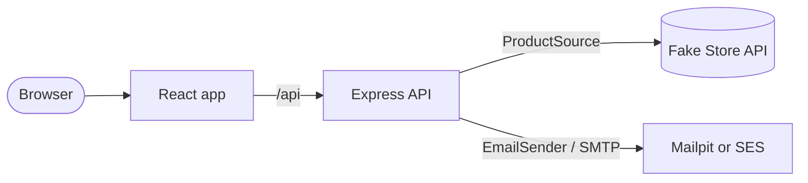

# Product Catalogue PoC

> **Status: in progress.** The plan is in place; the application is being built. Setup steps below will be verified once it exists.

A proof of concept for a product catalogue. Customers browse and search products and send an enquiry about one. It is built as a foundation that keeps working when the product data source, the look and feel and the email provider change.

Product data comes from the public [Fake Store API](https://fakestoreapi.com) through the backend. The browser never calls it.

## Features
| Feature | Behaviour |
|---|---|
| Home | Shows the 5 products the business chose as "top rated" |
| Category | Shows that category's top-rated products, then the rest |
| Search | Shows only products whose title, description or category contains every search word |
| Product | Clicking a product tile opens its details page |
| Enquiry | **Enquire** opens a contact form. Submitting emails the sales inbox and shows "Thank you" |

Assumptions behind each are in [DECISIONS.md](DECISIONS.md).

## Stack and why
| Layer | Choice | Why |
|---|---|---|
| Client | React + TypeScript (Vite) | Runs in any browser with no simulator. The static build deploys anywhere. |
| Backend | Node.js + TypeScript (Express) | Small and familiar. The data source and email provider sit behind plain interfaces, so swapping either is one new adapter. |
| Email | SMTP to Mailpit locally | A real inbox you can open, with no accounts. Production can point SMTP at Amazon SES. |
| Run | Docker Compose | One command starts the app, the API and the inbox. |



## Getting started
*To be verified after the build.* Planned:

### With Docker (recommended)
One command starts the frontend, the backend and the email inbox:
```sh
docker compose up --build
```
- App: http://localhost:8080
- Sales inbox (Mailpit): http://localhost:8025

No configuration needed; defaults work locally. To change settings (featured products, sales inbox address), copy `backend/.env.example` to `backend/.env` and edit it. The frontend has no settings: it only calls `/api` on its own origin.

### Without Docker (for development)
Needs Node.js 26 (`.nvmrc`). From the repo root, install once, then run each of the other three commands in its own terminal:
```sh
npm install
docker compose up mailpit     # email inbox only
npm run dev -w backend        # API on http://localhost:3000
npm run dev -w frontend       # app on http://localhost:5173, forwards /api to the backend
```

### Tests
```sh
npm test
```

## API
See [PLAN.md](PLAN.md#api).

## Time spent
| Phase | Minutes |
|---|---:|
| Planning | 35–40 |
| Building | |
| Testing | |
| Reviewing | |
| **Total** | |

## Documents
| File | Purpose |
|---|---|
| [PLAN.md](PLAN.md) | Spec: structure, API, work order, tests |
| [DECISIONS.md](DECISIONS.md) | Assumptions, cuts, growth path, next steps |
| [AI_USAGE.md](AI_USAGE.md) | How AI was used and checked |
| [AGENTS.md](AGENTS.md) | Instructions for AI coding agents |
